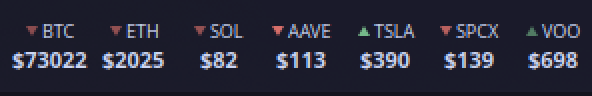

# Market Ticker — KDE Plasma widget

A compact Plasma 6 panel ticker: a short name over the current price, one widget per
asset, for crypto or stocks/ETFs. A small muted triangle before the name shows which
way the asset is moving, so a row of tickers tells you at a glance whether today is
all green, all red, or a mix.



## Features

- **Crypto** from [CoinGecko](https://www.coingecko.com) (no API key), priced in the
  currency you choose.
- **Stocks and ETFs** from Yahoo Finance by ticker symbol, e.g. `VOO`, `TSLA`, or with
  an exchange suffix such as `BHP.AX` or `SHOP.TO`.
- **Trend marker**: ▲/▼ in muted green/red before the name. It compares against the
  last 24 hours for crypto and the previous close for stocks. Moves under ±0.5 % show
  no marker; it fades in from there and is fully coloured at ±3 %. Hover for the
  exact change.
- Whole-number prices, refreshed every 15 minutes, with back-off when an API rate
  limits you.

## Install

```sh
git clone https://github.com/amalakhovsky/plasma-market-ticker
cd plasma-market-ticker
./install.sh
```

Then right-click your panel → **Add Widgets…** → **Market Ticker**, once per asset,
and right-click each → **Configure**:

- **Source**: Crypto (CoinGecko) or Stock / ETF (Yahoo Finance)
- **Coin and currency**, or **Ticker** and the **Label** shown above the price
- **Font size**

Stock prices are in the exchange's own currency; the symbol shown in front of them is
the one set in the widget's settings.

## Notes

- CoinGecko's free API allows only a few requests per minute. Each crypto widget makes
  its own request, so with many of them a burst of failures after logging in is
  normal; the widget backs off (up to 5 minutes) and recovers by itself.
- Yahoo Finance's chart endpoint is unofficial and may change.

## Credits

Based on **Plasma Coin** by zayronxio (GPL-3.0). This fork adds the two-line layout,
the stock/ETF source, the trend marker, rate-limit back-off and some fixes, and uses
its own widget ID so it can be installed alongside the original.

## License

GPL-3.0-or-later.
